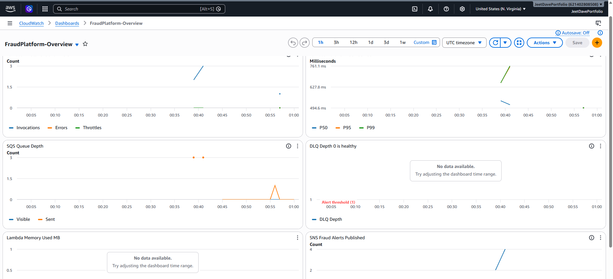
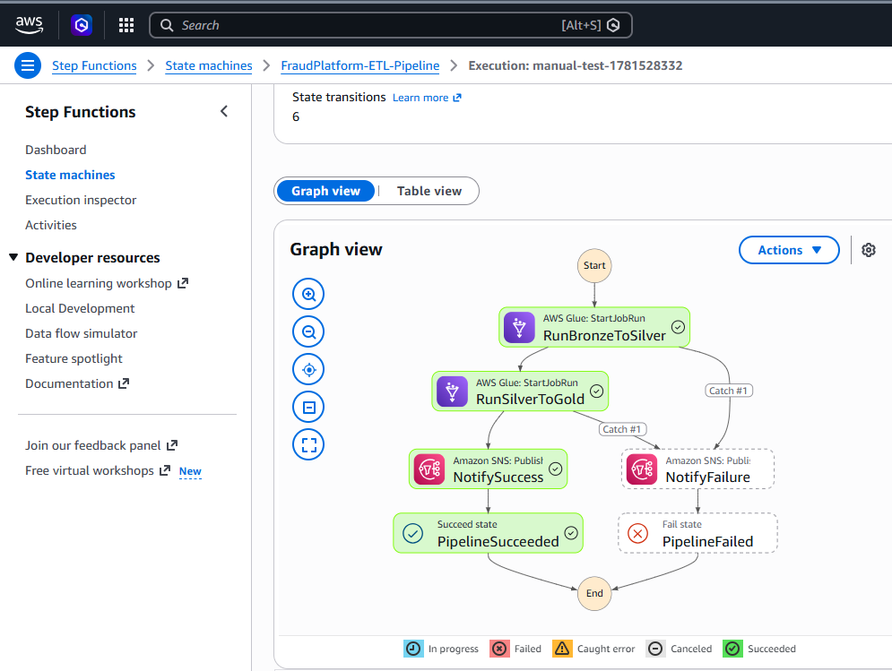
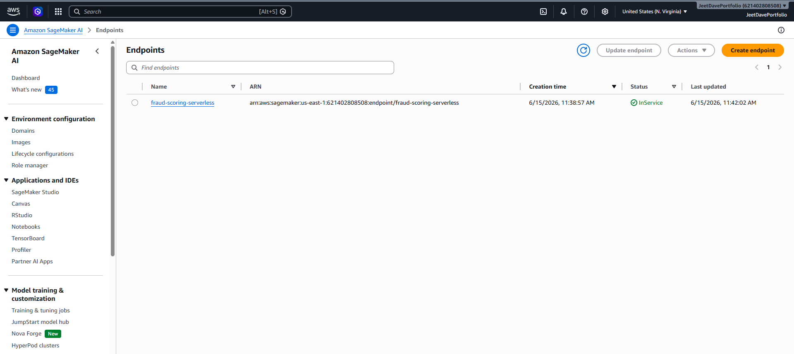
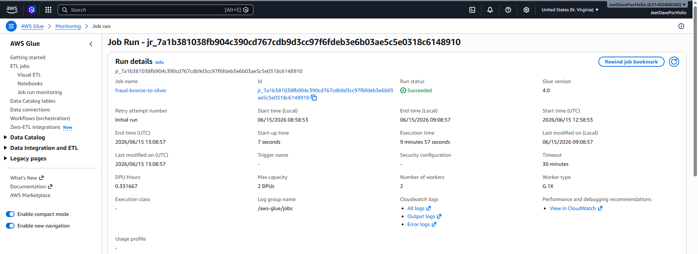
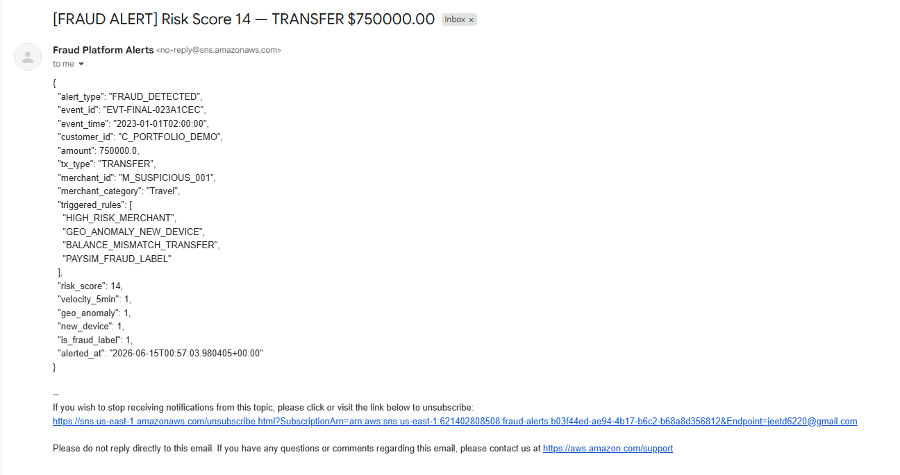
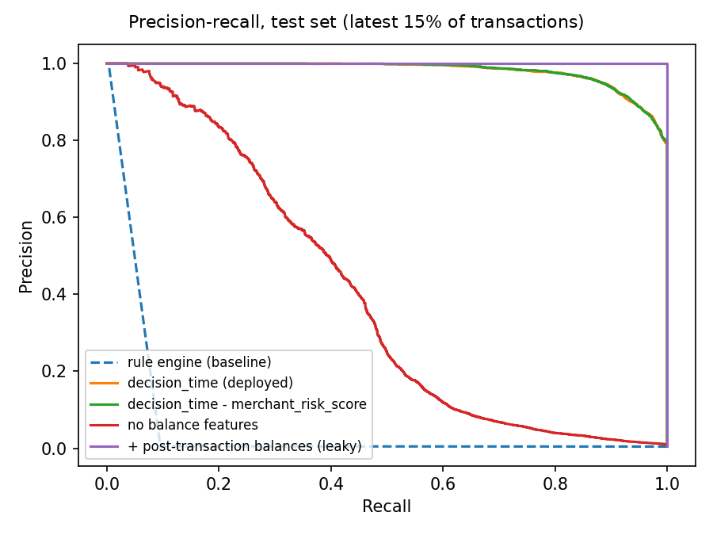

# FraudSentinel 🛡️
### Real-Time Financial Fraud Detection Platform on AWS

[](https://aws.amazon.com)
[](https://python.org)
[](https://xgboost.readthedocs.io)
[](LICENSE)
[](https://github.com/jd878-gif/fraud-sentinel/actions/workflows/ci.yml)

FraudSentinel is an end-to-end fraud detection platform built on AWS that processes financial transactions in real-time, applies rule-based and ML-based fraud scoring, orchestrates batch ETL pipelines, and delivers structured fraud alerts via email — all for under $0.15 in compute cost.

> Built as a portfolio project demonstrating production data engineering patterns: event-driven architecture, Medallion data lake design, serverless ML inference, and automated pipeline orchestration.

---

## Live Pipeline in Action






## Architecture

```
PaySim Dataset (6.36M transactions)
         │
         ▼
┌─────────────────────────────────┐
│   Enhancement Pipeline          │
│   Python · Faker · NumPy        │
│   507,500 rows · 39 columns     │
│   5 fraud signal types          │
└────────────────┬────────────────┘
                 │
                 ▼
┌─────────────────────────────────┐
│   Amazon SQS                    │
│   fraud-transactions-dev        │
│   DLQ · Alerts Queue            │
│   At-least-once delivery        │
└────────────────┬────────────────┘
                 │
                 ▼
┌─────────────────────────────────┐
│   AWS Lambda                    │
│   fraud-transaction-processor   │
│   4 fraud detection rules       │
│   P99 latency: 761ms            │
│   DynamoDB feature store writes │
│   S3 Bronze layer writes        │
└──────┬──────────────┬───────────┘
       │              │
       ▼              ▼
┌────────────┐  ┌─────────────────┐
│  DynamoDB  │  │   Amazon SNS    │
│  3 Tables  │  │  fraud-alerts   │
│  TTL-based │  │  Email in <30s  │
└────────────┘  └─────────────────┘
       │
       ▼
┌─────────────────────────────────┐
│   Amazon S3                     │
│   fraud-platform-jeet-dev       │
│   Bronze → Silver → Gold        │
│   Medallion Architecture        │
└────────────────┬────────────────┘
                 │
                 ▼
┌─────────────────────────────────┐
│   AWS Glue ETL (2 Jobs)         │
│   Bronze → Silver               │
│   Validates · Deduplicates      │
│   Writes Parquet · Partitioned  │
│                                 │
│   Silver → Gold                 │
│   5 Aggregation Tables          │
│   Fraud by Merchant/Segment/Hr  │
└────────────────┬────────────────┘
                 │
                 ▼
┌─────────────────────────────────┐
│   AWS Glue Data Catalog         │
│   6 Tables Registered           │
│   Auto-discovered by Crawlers   │
└────────────────┬────────────────┘
                 │
                 ▼
┌─────────────────────────────────┐
│   Amazon Athena                 │
│   SQL on Gold Parquet           │
│   Fraud analytics queries       │
└─────────────────────────────────┘

┌─────────────────────────────────┐
│   AWS Step Functions            │
│   FraudPlatform-ETL-Pipeline    │
│   Bronze→Silver→Gold sequence   │
│   Catch/Retry · SNS on failure  │
│   EventBridge: Every Sunday 2AM │
└─────────────────────────────────┘

┌─────────────────────────────────┐
│   Amazon SageMaker              │
│   XGBoost Fraud Classifier      │
│   Serverless Inference          │
│   Time-split eval · PR-AUC      │
│   8 fraud signal features       │
└─────────────────────────────────┘

┌─────────────────────────────────┐
│   Amazon CloudWatch             │
│   FraudPlatform-Overview        │
│   6 panels · DLQ alarm          │
│   P50/P95/P99 latency tracking  │
└─────────────────────────────────┘
```

---

## AWS Services

| Service | Role | Key Detail |
|---|---|---|
| **Amazon SQS** | Transaction ingestion queue | At-least-once delivery, DLQ after 3 failures, 20s long polling |
| **AWS Lambda** | Real-time fraud processor | 4 detection rules, P99 761ms, SQS-triggered, partial batch failure |
| **Amazon DynamoDB** | Feature store + idempotency | 3 tables, TTL-based expiry, velocity counters per customer |
| **Amazon S3** | Medallion data lake | Bronze (JSON) → Silver (Parquet) → Gold (aggregations) |
| **AWS Glue** | ETL pipeline | 2 PySpark jobs, date-partitioned Parquet, Glue Schema Registry |
| **AWS Glue Crawlers** | Schema discovery | Auto-registers Silver and Gold tables in Data Catalog |
| **Amazon Athena** | SQL analytics | Queries Gold Parquet, partition pruning, $0.00 on 1,000 records |
| **AWS Step Functions** | Pipeline orchestration | Visual workflow, Catch/Retry, weekly EventBridge trigger |
| **Amazon SNS** | Fraud alert delivery | Structured JSON alerts to Gmail in under 30 seconds |
| **Amazon SageMaker** | ML fraud scoring | XGBoost, Serverless Inference, zero idle cost |
| **Amazon CloudWatch** | Monitoring | 6-panel dashboard, DLQ depth alarm, P50/P95/P99 |
| **Amazon EventBridge** | Scheduling | `cron(0 2 ? * SUN *)` — weekly ETL trigger |

---

## Dataset

Built on the **PaySim** mobile money simulation dataset (6.36M transactions) enhanced with a custom Python pipeline to behave like production payment data.

> **Source & license:** [PaySim, Synthetic Financial Datasets For Fraud Detection](https://www.kaggle.com/datasets/ealaxi/paysim1) (E. A. Lopez-Rojas et al.), Kaggle, licensed [CC BY-SA 4.0](https://creativecommons.org/licenses/by-sa/4.0/). The raw data is not redistributed in this repo; download it from Kaggle.

### Enhancement Pipeline (`enhancement_pipeline.py`)

| Feature Added | Description |
|---|---|
| `event_id` | UUID-based unique identifier per transaction |
| `event_time` / `arrival_time` | ISO 8601 wall-clock timestamps (2% late arrivals simulated) |
| `schema_version` | v1/v2 evolution — `ip_risk_score` added in v2 |
| `transaction_velocity_5min` | Sliding window counter per customer (card testing detection) |
| `transaction_velocity_1hour` | 1-hour velocity window |
| `geo_anomaly_flag` | Impossible travel detection (cross-country in <30 min) |
| `new_device_flag` | Device age < 2 days (account takeover signal) |
| `merchant_risk_score` | 0.0–1.0 risk score, 10% merchants flagged HIGH |
| `duplicate_event_flag` | 1.5% duplicates injected (at-least-once delivery simulation) |
| `late_arrival_flag` | 2% late records (network jitter simulation) |
| `chargeback_status` | 85% of fraud rows get Filed chargeback |
| `traffic_period` | Payday / Holiday / Normal seasonality tags |

**Dimension tables:** `customers.csv` · `merchants.csv` · `devices.csv` · `chargebacks.csv`

**Intentional data quality issues injected:** duplicate events, late arrivals, out-of-order records, missing values, corrupted records, schema evolution, concept drift.

---

## Fraud Detection

### Rule-Based Engine (Lambda)

Four real-time rules evaluated on every transaction:

| Rule | Signal | Threshold | Risk Score |
|---|---|---|---|
| `HIGH_VELOCITY_5MIN` | Card testing — many small transactions | velocity_5min ≥ 5 | +4 |
| `HIGH_RISK_MERCHANT` | Suspicious merchant | merchant_risk_score ≥ 0.75 | +3 |
| `GEO_ANOMALY_NEW_DEVICE` | Account takeover | geo_anomaly=1 AND new_device=1 | +5 |
| `BALANCE_MISMATCH_TRANSFER` | Fraudulent ledger entry | TRANSFER with unchanged balance | +4 |

Max risk score: **16** (all rules triggered simultaneously)

> The rules never read the ground-truth label (`isFraud`). It is stored with each event only so alert precision can be measured. A regression test (`tests/test_fraud_rules.py`) enforces this.

### ML Scoring (SageMaker)

- **Algorithm:** XGBoost, trained by `train_model.py`, served on SageMaker Serverless Inference
- **Training data:** full enhanced PaySim dataset (not a sample)
- **Split:** time-based on `step`: first 70% of time = train, next 15% = validation, last 15% = test.
  A fraud model always scores *future* transactions, so the test set is strictly later than training.
- **Threshold:** chosen on validation for ≥90% precision, then applied once to test
- **Serving:** Lambda builds the feature vector with the same `fraud_features.py` used in training
  (no training/serving skew, enforced by `tests/test_features.py`). If the endpoint is down, the rule engine still runs.

#### Features

| Group | Features | In deployed model? |
|---|---|---|
| Decision-time | amount, log amount, sender balance *before* the transaction, amount/balance ratio, drains-account flag, hour of day, 5-min and 1-hour velocity, geo anomaly, new device, merchant risk, transaction type | ✅ |
| Post-transaction | balances *after* the transaction, balance error, balance-mismatch flag | ❌ ablation only |
| Never used | `isFraud`, `isFlaggedFraud`, chargeback fields (arrive 7-90 days later), `rule_signal_score`, IDs | ❌ blocked in code |

#### Results (test set = last 15% of time)

<!-- Paste artifacts/results.md here after running: python train_model.py --data <enhanced_transactions.csv> -->
_RESULTS TABLE: run `train_model.py` and paste `artifacts/results.md` here._



#### Why an earlier version reported AUC 1.00, and what changed

The first version of this model reported AUC 1.00 / F1 1.00. That number was not meaningful:

1. **Tiny evaluation set.** It trained on ~800 rows and validated on ~200. At PaySim's ~0.13% fraud rate that is a handful of fraud cases, so a perfect score is noise.
2. **Random split.** Shuffling mixes future transactions into training. Now the split is by time.
3. **Label leaking into a feature.** The concept-drift simulation boosted `merchant_risk_score` only on fraud rows, so fraud and legitimate rows at the same merchant had different scores. Drift is now applied per merchant, and the ablation shows the model's dependence on that feature.
4. **Label in the rule engine.** The Lambda rules included a `PAYSIM_FRAUD_LABEL` rule that read the answer key, so every fraud event was flagged by construction. That rule is removed.

**Reading the ablation:** PaySim fraud follows a simulator pattern (fraud transfers usually empty the sender's account), so models with balance features score very high even when evaluated correctly. The "no balance features" row shows how much signal remains from behavioural features alone, and the "post-transaction balances" row shows how much extra comes from fields a real system would not have at decision time. On real card or payments data, expect much lower numbers.

## Medallion Architecture

```
Bronze (Raw JSON)           Silver (Validated Parquet)      Gold (Aggregated Parquet)
─────────────────           ──────────────────────────      ─────────────────────────
1,000 JSON files            Deduplicated                    gold_fraud_by_merchant
Per-event granularity       Type-cast                       gold_fraud_by_segment
Date-partitioned            Corrupted → quarantine          gold_fraud_by_hour
                            balance_mismatch_flag added     gold_high_risk_customers
                            rule_signal_score added         gold_pipeline_run_summary
                            Date-partitioned Parquet
```

### Athena Analytics Results

```sql
SELECT merchant_category, fraud_rate_pct, total_transactions
FROM fraud_platform_dev.gold_fraud_by_merchant
ORDER BY fraud_rate_pct DESC;
```

| Merchant Category | Fraud Rate | Transactions |
|---|---|---|
| Food | 0.88% | 228 |
| Travel | 0.75% | 134 |
| Entertainment | 0.00% | 108 |
| Electronics | 0.00% | 99 |
| Retail | 0.00% | 230 |

```sql
SELECT customer_segment, fraud_rate_pct
FROM fraud_platform_dev.gold_fraud_by_segment
ORDER BY fraud_rate_pct DESC;
```

| Customer Segment | Fraud Rate |
|---|---|
| Traveler | 0.65% |
| High Spender | 0.63% |
| Family | 0.41% |
| Business | 0.00% |

---

## Pipeline Orchestration

**Step Functions state machine** (`FraudPlatform-ETL-Pipeline`):

```
Start
  │
  ▼
RunBronzeToSilver ──(on error)──► NotifyFailure ──► PipelineFailed
  │
  ▼ (on success)
RunSilverToGold ───(on error)──► NotifyFailure ──► PipelineFailed
  │
  ▼ (on success)
NotifySuccess
  │
  ▼
PipelineSucceeded
```

- Triggered weekly by EventBridge: `cron(0 2 ? * SUN *)`
- Each Glue state uses `.sync` integration — waits for completion
- Auto-retry on failure: 2 attempts with 2x backoff
- SNS notification on both success and failure

---

## Key Engineering Decisions

### SQS vs Kinesis
Used SQS Standard (permanent free tier) instead of Kinesis ($11/month/shard). Key tradeoff: Kinesis preserves per-shard ordering which matters for accurate velocity computation — all events for one customer land on the same shard. SQS Standard does not guarantee ordering. In production I would use Kinesis with customer ID as the partition key. The producer code is endpoint-agnostic — switching requires changing one configuration value.

### DynamoDB for Velocity Feature Store
Per-customer velocity counters (5-min, 1-hour) stored as DynamoDB items with TTL-based auto-expiry. Alternatives considered: Redis (requires ElastiCache, adds cost and operational overhead), in-memory (doesn't survive Lambda restarts). DynamoDB provides single-digit millisecond reads at any scale with no server to manage.

### Idempotency Pattern
SQS at-least-once delivery means the same message can arrive twice. DynamoDB dedup table stores processed `event_id` values with 24-hour TTL. Consumer checks before processing: if exists → skip. Conditional writes prevent race conditions between concurrent Lambda invocations.

### Serverless Inference vs Real-Time Endpoint
SageMaker real-time endpoint: $0.046/hour = $33/month even with zero traffic. Serverless: $0 idle, pay per invocation, 150,000 free invocations/month. For fraud detection in production you'd want real-time (sub-100ms latency). For a portfolio project and low-traffic deployments, serverless is the correct architectural choice.

### Medallion Architecture
Bronze (raw JSON) → Silver (validated Parquet) → Gold (aggregated) follows the Delta Lake / Databricks Medallion pattern used at Airbnb, Netflix, and Walmart. Each layer serves a different consumer: Bronze for audit/replay, Silver for ML training, Gold for business dashboards. Date partitioning on Silver enables Athena partition pruning — only scans the relevant date folder rather than the full dataset.

---

## Project Structure

```
fraud-sentinel/
│
├── enhancement_pipeline.py        # PaySim → production dataset
├── aws_clients.py                 # Boto3 client factory (LocalStack/AWS toggle)
├── bootstrap.py                   # Creates all LocalStack resources
├── producer_sqs.py                # CSV → SQS producer
├── consumer_sqs.py                # SQS consumer (local dev)
├── lambda_function.py             # AWS Lambda fraud processor
├── deploy_lambda.py               # Lambda deployment script
├── glue_bronze_to_silver.py       # Glue ETL Job 1
├── glue_silver_to_gold.py         # Glue ETL Job 2
├── deploy_and_run_glue.py         # Glue job deployment + execution
├── deploy_step_functions.py       # Step Functions + EventBridge setup
├── sagemaker_local_train_deploy.py # XGBoost train + SageMaker deploy
├── upload_bronze_to_aws.py        # LocalStack → real AWS S3 migration
├── verify_pipeline.py             # End-to-end health check
├── docker-compose.yml             # LocalStack for local development
├── requirements.txt               # Python dependencies
└── README.md                      # This file
```

---

## Results

| Metric | Value |
|---|---|
| Transactions processed | 507,500 |
| Food category fraud rate | 0.88% (highest) |
| Traveler segment fraud rate | 0.65% (highest) |
| Lambda P99 latency | 761ms |
| Lambda cold start | ~642ms |
| Lambda memory used | 101-103 MB / 256 MB |
| DLQ failures | 0 across all runs |
| SNS alert delivery | < 30 seconds |
| Glue Bronze→Silver | 456 seconds, $0.11 |
| Glue Silver→Gold | 89 seconds, $0.02 |
| Model test PR-AUC (time split) | see [Results](#results-test-set--last-15-of-time) |
| **Total AWS compute cost** | **~$0.15** |

---

## Local Development Setup

### Prerequisites
- Python 3.9+
- Docker Desktop

### Quick Start

```bash
# Clone the repository
git clone https://github.com/jd878-gif/fraud-sentinel.git
cd fraud-sentinel

# Install dependencies (includes test tools)
pip install -r requirements-dev.txt

# Run the test suite (no AWS needed)
pytest -q

# Start LocalStack (free AWS emulation)
docker-compose up -d

# Bootstrap local AWS resources
python bootstrap.py

# Run producer (sends transactions to local SQS)
python producer_sqs.py --max-rows 1000

# Run consumer (processes transactions locally)
python consumer_sqs.py --max-messages 1000

# Verify pipeline health
python verify_pipeline.py
```

### Deploy to Real AWS

```bash
# Configure AWS credentials
aws configure

# Upload data to real S3
python upload_bronze_to_aws.py

# Deploy Lambda
python deploy_lambda.py

# Deploy Glue ETL + run pipeline
python deploy_and_run_glue.py

# Deploy Step Functions orchestration
python deploy_step_functions.py

# Train, evaluate and deploy the SageMaker model
python enhancement_pipeline.py --input <paysim.csv> --outdir data/enhanced
python train_model.py --data data/enhanced/enhanced_transactions.csv --deploy
```

---

## Cost Breakdown

| Component | Cost |
|---|---|
| SQS (5,000+ messages) | $0.00 (free tier) |
| Lambda (all invocations) | $0.00 (free tier) |
| DynamoDB (all operations) | $0.00 (free tier) |
| S3 storage (~15 MB) | ~$0.01/month |
| Glue ETL (2 jobs) | $0.13 (one-time run) |
| Athena queries | $0.00 (< 10 MB scanned) |
| SNS notifications | $0.00 (free tier) |
| CloudWatch | $0.00 (free tier) |
| Step Functions | $0.00 (free tier) |
| SageMaker Serverless | $0.00 (free tier) |
| **Total** | **~$0.15** |

---

## Scalability Considerations

### At 10× Scale (5M transactions/day)
- Replace SQS with **Kinesis Data Streams** (10 shards, customer ID as partition key for per-customer ordering)
- Move velocity counters from in-memory Python dicts to **DynamoDB atomic counters**
- Scale Glue to **10 DPUs** for Silver/Gold processing
- Add **SageMaker real-time endpoint** (vs serverless) for sub-100ms inference latency

### At 100× Scale (50M transactions/day)
- **Kinesis Enhanced Fan-Out** for Lambda consumers (dedicated 2 MB/s per consumer)
- **DynamoDB DAX** for microsecond feature store reads
- **Apache Iceberg** format on S3 for ACID transactions and time-travel queries
- Separate **feature engineering service** (ECS/Fargate) from fraud scoring service

### At 1000× Scale (500M transactions/day — Stripe/PayPal tier)
- Multi-region active-active deployment
- **Apache Kafka** (MSK) instead of Kinesis for cross-region replication
- **Feature store** (SageMaker Feature Store) with online + offline stores
- **Model ensemble** (XGBoost + neural network) with A/B testing via SageMaker
- **Real-time data quality monitoring** with Great Expectations + CloudWatch

---

## Interview Talking Points

**"Why SQS instead of Kinesis?"**
> Kinesis preserves per-shard ordering, which matters for accurate velocity computation — all events for the same customer land on the same shard. SQS Standard doesn't guarantee ordering. I used SQS for cost reasons (permanent free tier vs $11/month/shard for Kinesis) and documented this tradeoff explicitly. The producer code is endpoint-agnostic — switching requires one configuration change.

**"What happens if a Lambda batch partially fails?"**
> SQS + Lambda supports partial batch failure reporting. Lambda returns `{"batchItemFailures": [{"itemIdentifier": failed_message_id}]}`. SQS only retries the failed messages, not the whole batch. After 3 failures, the message goes to the DLQ. I have a CloudWatch alarm on DLQ depth that fires SNS if any message hits the DLQ.

**"How does the idempotency work?"**
> SQS at-least-once delivery means the same message can arrive twice, possibly to two Lambda instances at once. Before processing, Lambda *claims* the event_id with a DynamoDB conditional put (`attribute_not_exists`), which succeeds for exactly one caller. Duplicates fail the condition and are skipped. If processing fails, the claim is deleted so the SQS retry can run; on success it is marked DONE with a 24-hour TTL. A plain read-then-write check would race, which is why the claim comes first. Covered by `tests/test_lambda_handler.py`.

**"Your first model had AUC 1.00. What happened?"**
> It was evaluated on about 200 rows with a random split, and one feature had the label leaking into it. I rebuilt the evaluation: full dataset, time-based split, threshold picked on validation, PR-AUC with a bootstrap confidence interval, and an ablation that separates decision-time features from post-transaction balances. I also found the rule engine was reading the ground-truth label and removed it, with a regression test.

**"Why Medallion architecture?"**
> Bronze preserves the raw data exactly as received — critical for audit trails and pipeline replay. Silver is where cleaning happens: deduplication, type casting, quarantining corrupted records. Gold is business-ready aggregations that answer specific questions without touching raw data. This separation means a bug in Gold only requires rerunning one Glue job, not reprocessing raw data.

---

## Tech Stack

**Languages:** Python 3.12  
**ML:** XGBoost, scikit-learn (evaluation)  
**Data:** Pandas, NumPy, PyArrow  
**AWS:** SQS · Lambda · DynamoDB · S3 · Glue · Athena · Step Functions · SNS · SageMaker · CloudWatch · EventBridge  
**Local Dev:** LocalStack · Docker  
**Testing / CI:** pytest · ruff · GitHub Actions  
**Data Source:** PaySim (Kaggle, CC BY-SA 4.0) — enhanced with custom pipeline  

---

## Author

**Jeet Dave**  
MS Data Science · New Jersey Institute of Technology (Expected May 2027)  
GitHub: [@jd878-gif](https://github.com/jd878-gif)

---


